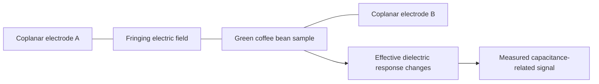
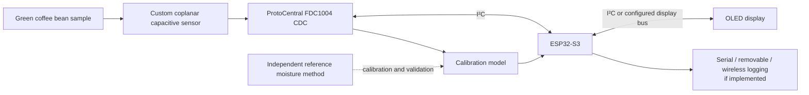
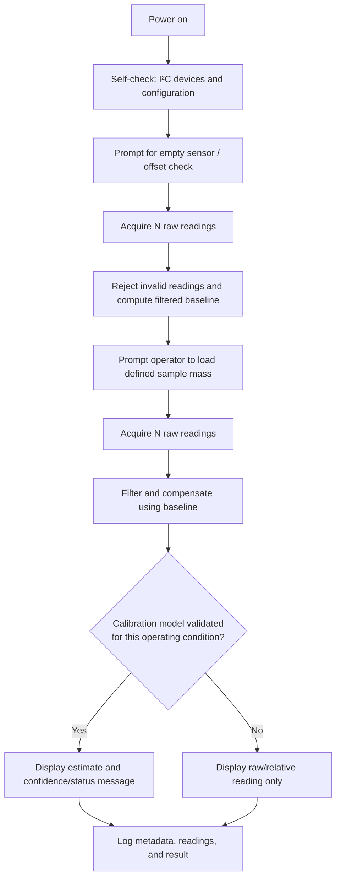
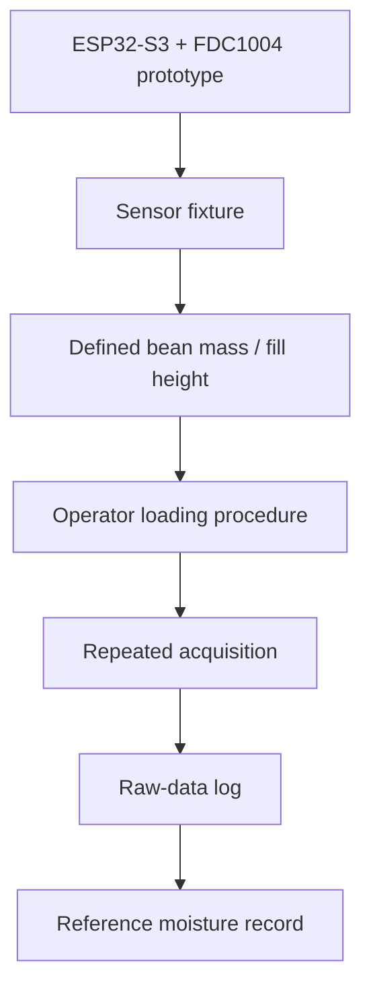
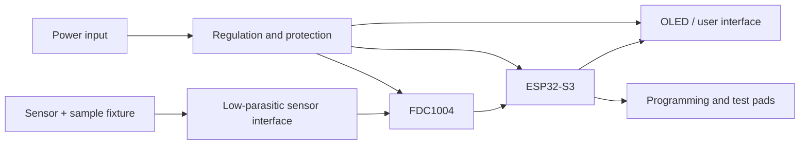
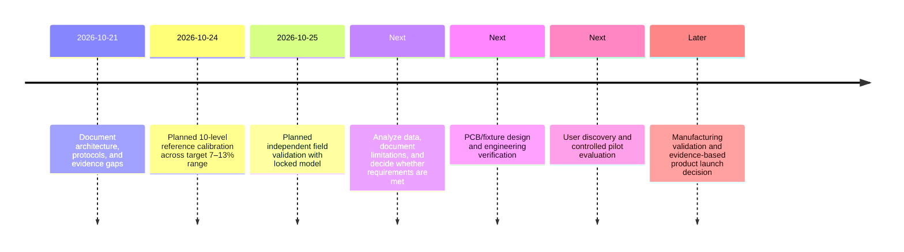

# Smart Co-plannar Capacitive Moisture Meter 


Project investigates a compact instrument for estimating the moisture content of green coffee beans using a custom coplanar capacitive sensor. An ESP32-S3 acquires capacitance-related measurements through a ProtoCentral FDC1004 capacitive-to-digital-converter (CDC) board, processes the data, and presents a usable reading on an OLED display.

The technical hypothesis is that, for a controlled bean type, sample mass/packing condition, temperature, and sensor geometry, changes in green-coffee moisture will produce a measurable change in the sensor's effective capacitance. A calibration model is required before the device can report moisture percentage.

## Objectives

- Develop a repeatable capacitive sensing method for green coffee beans.
- Acquire stable sensor readings with an ESP32-S3 and FDC1004.
- Build a reference calibration across the intended 7–13% moisture range.
- Compare device estimates against an independent reference method.
- Evaluate the prototype's path to a manufacturable PCB-based product.

## Project phases and current state

| Phase | Deliverable | State | Evidence / next action |
|---|---|---|---|
| 1. Problem definition | Moisture-measurement use case and component concept | **Confirmed** | Preserve the target user, sample type, and decision the reading supports. |
| 2. Sensing principle | Capacitance mechanism and sensor concept | **Confirmed (concept)** | Quantify sensitivity with controlled samples. |
| 3. Hardware integration | ESP32-S3, FDC1004, custom sensor, OLED connected and readable | **To verify** | Record wiring, board revision, I²C scan, and a display photograph. |
| 4. Firmware baseline | Measurement, filtering, UI, logging | **To verify** | Version the source and record build/functional tests. |
| 5. Offset calibration | Empty/fixture baseline and drift procedure | **In progress / To verify** | Run the documented procedure below and retain raw data. |
| 6. Reference calibration | Ten reference levels spanning 7–13% moisture | **Planned — 24 Oct 2026** | Use traceable/reference moisture values and a predeclared analysis plan. |
| 7. Independent validation | Field or independent test-set comparison | **Planned — 25 Oct 2026** | Keep validation samples independent of model fitting. |
| 8. Product engineering | Integrated PCB, enclosure, DFM/DFT review | **Planned** | Convert prototype learning into requirements and design files. |
| 9. Commercial validation | User interviews, pricing study, pilot feedback | **Planned** | Do not claim demand until evidence is collected. |

---

## 1. Basic concepts: capacitance and moisture sensing

### 1.1 Capacitance in this application

For an ideal parallel-plate capacitor:

```math
C = \frac{\varepsilon A}{d}
```

where `C` is capacitance, `ε` is permittivity of the material between and around the electrodes, `A` is effective electrode area, and `d` is electrode separation. The custom sensor here uses **coplanar** electrodes rather than opposing plates, so its electric field is fringing and extends into the bean sample above the surface. The exact field distribution depends on electrode geometry, substrate, housing, sample depth, and nearby conductive objects.

Water has a much higher dielectric response than dry organic material at relevant conditions. As moisture changes, the effective dielectric properties seen by the fringing field can change, shifting the measured capacitance. The measured signal is therefore an indirect proxy for moisture—not moisture percentage by itself.

### 1.2 Why calibration is essential

The sensor may respond to factors other than moisture, including:

- Bean variety, origin, processing method, density, and particle/bean size
- Sample mass, fill height, compaction, orientation, and air gaps
- Temperature, humidity, contamination, and material left on the sensor
- Cable length, parasitic capacitance, electrical noise, and mechanical movement
- Sensor geometry, PCB material, grounding, and enclosure effects

Calibration maps a repeatable measurement feature (for example, compensated capacitance or a filtered CDC code) to a reference moisture value under defined conditions. Its usefulness is limited to the population and operating conditions it represents.

### Diagram placeholder — sensing principle

Replace or refine this editable Mermaid diagram with the project's final field-line drawing or insert an image below it.



`<!-- INSERT FIGURE: Sensor geometry, dimensions, substrate, and sample-volume sketch -->`

---

## 2. System architecture

### 2.1 Functional architecture

| Block | Intended role | Design notes to capture |
|---|---|---|
| Custom coplanar sensor | Couples a fringing electric field into the bean sample | Electrode width/spacing, copper thickness, substrate, guard features, sample fixture. |
| ProtoCentral FDC1004 | Converts capacitance-related input to digital readings | Channel configuration, measurement rate, offset/capacitance-range settings, shield/ground arrangement. |
| ESP32-S3 | Configuration, acquisition, processing, logging, and UI control | Firmware version, I²C pins/address, sample timing, reset behavior, power mode. |
| OLED | Presents prompts, raw/processed readings, status, and estimate | Screen size/driver, layout, user prompts, fault messages. |
| Power and interconnect | Supplies stable power and connects modules | Supply voltage, regulator, battery/USB choice, cable lengths, grounding. |
| Reference method | Supplies known moisture values for calibration/validation | Instrument/method, operator, sample handling, uncertainty/traceability. |

### Diagram placeholder — block diagram



`<!-- INSERT FIGURE: Final wiring/schematic diagram. Label supply rails, common ground, I²C SDA/SCL, pull-ups, and sensor connector pins. -->`


### 2.2 Wiring and pin-map record

Populate with the **actual measured/verified pin assignments**

| Connection | Source pin | Destination pin | Signal / voltage | Verified? | Notes |
|---|---|---|---|---|---|
| ESP32-S3 ↔ FDC1004 | `[fill]` | `[fill]` | SDA | ☐ | I²C pull-up location/value: `[fill]` |
| ESP32-S3 ↔ FDC1004 | `[fill]` | `[fill]` | SCL | ☐ | Bus speed: `[fill]` |
| ESP32-S3 ↔ FDC1004 | `[fill]` | `[fill]` | GND | ☐ | Common-ground check: `[fill]` |
| ESP32-S3 ↔ FDC1004 | `[fill]` | `[fill]` | Power | ☐ | Confirm board voltage requirements. |
| FDC1004 ↔ sensor | `[fill]` | `[fill]` | Sense channel(s) | ☐ | Cable/trace length: `[fill]` |
| ESP32-S3 ↔ OLED | `[fill]` | `[fill]` | Display bus/power | ☐ | Driver/controller: `[fill]` |

---

## 3. Firmware and data architecture

### 3.1 Measurement workflow



### 3.2 Software modules

| Module | Responsibility | Output / record |
|---|---|---|
| `hardware_init` | Start I²C, FDC1004, OLED, and optional storage/communications | Device-detection and configuration log |
| `sensor_read` | Trigger/read conversions; detect out-of-range or communication faults | Timestamped raw values and flags |
| `baseline` | Empty-sensor offset measurement and baseline validity check | Baseline value, spread, timestamp |
| `signal_processing` | Median/mean filtering, outlier rules, drift and temperature compensation if validated | Processed feature and quality flags |
| `calibration_model` | Apply a versioned model only within its approved range | Estimate, model ID, extrapolation warning |
| `ui` | Guide operator and make failures visible | User prompts/status messages |
| `data_logger` | Save raw data, metadata, configuration, and model version | CSV/JSON log for traceability |

### 3.3 Pseudocode placeholder

```text
initialize_hardware()
assert_devices_present_or_show_error()

baseline = collect_and_validate_empty_sensor_baseline()
prompt_operator_for_standardized_sample_loading()

raw = collect_n_readings()
feature = filter_and_compensate(raw, baseline)

if approved_calibration_exists_for(current_sample_class, conditions):
    estimate = apply_versioned_calibration(feature)
    display(estimate, model_version, quality_status)
else:
    display_relative_signal(feature, "Calibration not validated")

log(raw, feature, baseline, sample_metadata, firmware_version, model_version)
```

### 3.4 Data record template

Keep raw values; do not retain only the final estimate.

| Field | Example / expected entry |
|---|---|
| Record ID | Unique identifier |
| Date/time and operator | ISO timestamp; operator initials/ID |
| Sensor/fixture revision | Hardware revision and geometry ID |
| Firmware and model version | Git/tag or version string |
| Sample ID | Blind/traceable sample identifier |
| Bean attributes | Variety/origin/process/lot, if known |
| Sample mass and loading procedure | Mass, fill height, packing instruction |
| Ambient conditions | Temperature/humidity if measured |
| Baseline values | Individual readings, summary, timestamp |
| Raw FDC1004 outputs | All individual readings and configuration |
| Processed feature | Filtered/compensated value and method |
| Reference moisture | Value, method/instrument, units, provenance |
| Device estimate | Value only when a locked model is used |
| Quality flags | Drift, outlier, communications, operator deviation |

---

## 4. Prototype procedure and offset calibration

### 4.1 Standardize the sample before measuring

For each trial, define and document:

1. A clean, dry sensor surface and fixture condition.
2. A fixed sample mass or fill-height target.
3. A consistent loading and settling/compaction instruction.
4. A set stabilization time after loading.
5. An agreed number of repeated reads and spacing between them.
6. Rules for cleaning, re-zeroing, and rejecting a run.

These choices reduce uncontrolled variation. They must be locked before comparing data across days or users.

### 4.2 Offset-calibration procedure

| Step | Action | Data to retain | Acceptance decision |
|---|---|---|---|
| 1 | Warm up electronics for a predeclared duration | Start/end time, supply condition, room conditions | Continue only after defined stabilization. |
| 2 | Inspect and clean sensor/fixture | Operator, cleaning method, photo if useful | Stop if residue or damage is visible. |
| 3 | Leave the sensing area empty using the defined fixture state | Fixture ID/configuration | Empty state must be reproducible. |
| 4 | Acquire `N` baseline readings | Every raw value and timestamp | Flag communication/range errors. |
| 5 | Calculate baseline summary and spread | Mean/median, SD/range, chosen filter | Compare to a **predefined** limit once one is justified by data. |
| 6 | Repeat baseline after sample removal | Before/after baseline comparison | Flag drift or contamination if change exceeds chosen rule. |
| 7 | Save baseline with the trial | Metadata + firmware/configuration | Do not overwrite historical baselines. |

> **Important:** No numeric stability threshold is specified yet, because none has been measured or accepted. Establish it from pilot data before treating a baseline as valid.

### Diagram placeholder — prototype and measurement setup



`<!-- INSERT FIGURE: Prototype photograph with callouts for ESP32-S3, FDC1004, sensor, OLED, power, and sample fixture. -->`

---

## 5. Reference calibration plan — 24 October 2026

### 5.1 Purpose and boundary

**Planned date:** 24 October 2026  
**Target calibration range:** 7–13% moisture  
**Planned structure:** 10 reference levels

The target range and count define the plan; they do **not** demonstrate that the device will be linear, accurate, stable, or usable across that range. The reference method should be specified before data collection and used consistently.

### 5.2 Pre-registration checklist

Before collecting data, record the following in the lab notebook or repository:

- Reference moisture method, instrument/model, units, operator, and traceability.
- Definition of each reference level and how samples will be produced, equilibrated, stored, and labeled.
- Bean type/lot and whether calibration is intended to generalize beyond it.
- Fixed sensor geometry, firmware/configuration, sample mass/loading, and ambient-condition plan.
- Replicate count per level and rule for repeats, exclusions, missing data, and invalid readings.
- Candidate model form(s) and the rule for selecting/locking a final model.
- A separate, withheld validation set or clear split rule so evaluation is not performed solely on the fitted data.

### 5.3 Ten-level calibration worksheet

Populate measured values rather than assuming evenly spaced levels are achievable or valid.

| Level | Target/reference moisture (%) | Sample ID | Reference method/result | Replicate count | Mean processed sensor feature | Spread | Included in fit? | Notes |
|---:|---:|---|---|---:|---:|---:|---|---|
| 1 | `[fill]` | `[fill]` | `[fill]` | `[fill]` | `[fill]` | `[fill]` | `[yes/no]` | |
| 2 | `[fill]` | `[fill]` | `[fill]` | `[fill]` | `[fill]` | `[fill]` | `[yes/no]` | |
| 3 | `[fill]` | `[fill]` | `[fill]` | `[fill]` | `[fill]` | `[fill]` | `[yes/no]` | |
| 4 | `[fill]` | `[fill]` | `[fill]` | `[fill]` | `[fill]` | `[fill]` | `[yes/no]` | |
| 5 | `[fill]` | `[fill]` | `[fill]` | `[fill]` | `[fill]` | `[fill]` | `[yes/no]` | |
| 6 | `[fill]` | `[fill]` | `[fill]` | `[fill]` | `[fill]` | `[fill]` | `[yes/no]` | |
| 7 | `[fill]` | `[fill]` | `[fill]` | `[fill]` | `[fill]` | `[fill]` | `[yes/no]` | |
| 8 | `[fill]` | `[fill]` | `[fill]` | `[fill]` | `[fill]` | `[fill]` | `[yes/no]` | |
| 9 | `[fill]` | `[fill]` | `[fill]` | `[fill]` | `[fill]` | `[fill]` | `[yes/no]` | |
| 10 | `[fill]` | `[fill]` | `[fill]` | `[fill]` | `[fill]` | `[fill]` | `[yes/no]` | |

### 5.4 Suggested analysis plan

1. Plot each replicate and its reference value before choosing a model.
2. Inspect response shape and variance across the range; do not assume linearity.
3. Fit only predeclared, physically reasonable candidate models (for example, linear and a limited nonlinear alternative if justified).
4. Preserve model coefficients, fit code, training-record IDs, model version, and inclusion/exclusion decisions.
5. Evaluate residuals and error against withheld or later independent samples. Report the number of samples and conditions with every metric.
6. Report repeatability separately from agreement with the reference method.
7. Define the approved operating range and show an out-of-range or unvalidated-condition warning in the UI.

### Diagram placeholder — calibration workflow


---

## 6. Independent field validation — 25 October 2026

### 6.1 Purpose

**Planned date:** 25 October 2026  
**Status:** Planned; no field outcome or customer validation is currently claimed.

This activity should test a locked calibration model on samples not used to fit or tune it. Ideally, the person performing device tests is blind to the reference results until data capture is complete.

### 6.2 Validation experiment plan

| Item | Planned requirement | Record here |
|---|---|---|
| Model | Use a dated, locked model/version from calibration | `[fill]` |
| Samples | Independent samples not used for fitting | `[fill]` |
| Reference | Same defined reference method or justified equivalent | `[fill]` |
| Operators | Record training level and operator IDs; consider more than one | `[fill]` |
| Environment | Record location, temperature/humidity if available | `[fill]` |
| Protocol | Use locked mass/loading/settling/offset procedure | `[fill]` |
| Blinding | Keep reference results unavailable during device measurement where practical | `[fill]` |
| Repeatability | Repeated measures on defined subset | `[fill]` |
| Failure handling | Record—not silently remove—out-of-range, drift, and operator errors | `[fill]` |

### 6.3 Validation report table

| Validation sample ID | Device estimate (%) | Reference moisture (%) | Difference | Replicate spread | Conditions / deviations | Accepted? |
|---|---:|---:|---:|---:|---|---|
| `[fill]` | `[fill]` | `[fill]` | `[fill]` | `[fill]` | `[fill]` | `[yes/no]` |

### 6.4 Reporting discipline

Only report accuracy, bias, repeatability, or agreement after the planned measurements are completed and the sample count, reference method, operating conditions, and exclusions are disclosed. If validation reveals failure modes, preserve them as product requirements rather than removing them from the record.

---

## 7. Data collection and analysis

### 7.1 Dataset structure

Suggested files:

```text
data/
  raw/
    YYYY-MM-DD_trial-001.csv
  processed/
    YYYY-MM-DD_trial-001_processed.csv
  reference/
    YYYY-MM-DD_reference-results.csv
  metadata/
    YYYY-MM-DD_trial-001.json
analysis/
  calibration/
  validation/
docs/
  protocols/
```

### 7.2 Minimum columns for a raw log

```csv
timestamp_utc,record_id,sample_id,operator_id,firmware_version,sensor_revision,fdc1004_configuration,baseline_value,raw_reading,filtered_feature,reference_moisture_pct,reference_method,ambient_temperature_c,ambient_relative_humidity_pct,sample_mass_g,loading_protocol_id,quality_flag,notes
```

### 7.3 Analysis outputs to include in the presentation

| Output | Why it matters | Status |
|---|---|---|
| Raw signal vs. reference moisture scatter plot | Shows response shape and overlap | Planned |
| Per-level replicate plot | Reveals repeatability and outliers | Planned |
| Baseline over time | Shows drift/warm-up behavior | Planned |
| Predicted vs. reference plot | Shows agreement only after model is locked | Planned |
| Residual plot | Reveals range-dependent bias and model mismatch | Planned |
| Environmental/handling comparison | Identifies confounders | Planned |
| Failure-mode log | Turns observed issues into design requirements | Planned |

`<!-- INSERT FIGURE: Calibration scatter plot with individual replicate points, model line, and explicitly labelled dataset split. -->`

`<!-- INSERT FIGURE: Validation predicted-vs-reference plot after 25 Oct 2026 data collection. Include sample count and conditions. -->`

---

## 8. Difficulties, limitations, and risk controls

| Risk / limitation | Why it matters | Proposed mitigation | Evidence needed | Status |
|---|---|---|---|---|
| Sensor response to packing/air gaps | May be mistaken for moisture change | Fixed mass, fixture, fill height, and loading SOP | Controlled packing study | Open |
| Bean-to-bean / lot variability | A model may not transfer across coffees | Record sample taxonomy; test transfer deliberately | Independent lots/varieties | Open |
| Temperature and humidity effects | Can shift dielectric/electronic response | Log conditions; test compensation only if supported by data | Environmental trials | Open |
| Baseline drift | Reduces comparability over time | Warm-up, pre/post baselines, re-zero prompts | Drift study | Open |
| Fringing-field sensitivity to surroundings | Hands, cables, metal, or enclosure can affect readings | Fixed fixture, shielding/guarding investigation, PCB layout controls | A/B interference tests | Open |
| FDC1004 configuration/range limits | Can cause clipping, noise, or unusable signals | Document configuration and test expected signal span | Raw capture review | Open |
| Sample/reference mismatch | Makes calibration labels unreliable | Define sampling, storage, and reference workflow | Chain-of-custody and method record | Open |
| Overfitting | Good calibration fit may not generalize | Withhold independent data; lock model before validation | Validation report | Open |
| Operator variability | May dominate field performance | Simple UI prompts and user study | Inter-operator trial | Open |
| Food-contact / contamination considerations | A product needs appropriate material and cleaning design | Select appropriate materials and cleaning process | Materials review | Planned |

## 9. Path from prototype to PCB

### 9.1 PCB implementation goals

- Integrate the ESP32-S3, FDC1004, display connector, power regulation, programming/debug access, and sensor connector/area into a documented schematic and layout.
- Reduce parasitic capacitance and noise by minimizing sensitive trace length and controlling return paths.
- Evaluate guard/shield strategy and keep digital/power circuitry away from the sensitive sensor input where practical.
- Add test points and a manufacturing/programming method.
- Design a repeatable sample fixture and enclosure as part of the sensing system, not as an afterthought.

### 9.2 PCB design-review checklist

| Topic | Review question | Status |
|---|---|---|
| Sensor interface | Are sensitive input traces short, protected, and documented? | ☐ |
| Grounding/returns | Are return paths and analog/digital interaction deliberate? | ☐ |
| Power | Are regulator noise, decoupling, and supply range reviewed? | ☐ |
| I²C/display | Are pull-ups, address conflicts, and connector behavior documented? | ☐ |
| RF behavior | Is ESP32-S3 antenna clearance respected for the selected module? | ☐ |
| Testability | Are programming, reset, supply, ground, and key signals accessible? | ☐ |
| Mechanics | Does the enclosure locate the sample and protect the sensor consistently? | ☐ |
| Serviceability | Can the sensor surface be cleaned and inspected? | ☐ |
| Revision control | Are schematic, layout, BOM, Gerbers, and assembly files versioned? | ☐ |

### Diagram placeholder — PCB/product concept



`<!-- INSERT FIGURE: PCB floor-plan or final layout screenshot. -->`

---

## 10. Manufacturing and productization roadmap

| Stage | Goal | Key outputs | Exit evidence |
|---|---|---|---|
| Engineering prototype | Demonstrate measurable, repeatable sensing under defined lab conditions | Prototype, SOP, raw dataset | Documented functional and baseline tests |
| Calibration prototype | Establish a constrained model for defined coffee/sample conditions | Reference dataset, model version, calibration report | Independent data reserved for evaluation |
| Field prototype | Test usability and robustness outside the lab | Locked firmware/model, field protocol, issue log | Independent validation report |
| PCB pilot | Integrate electronics and mechanical fixture | Schematic/layout, pilot units, test procedure | Bring-up and unit-to-unit comparison |
| Design verification | Test requirements and failure modes | Verification matrix, traceability record | Reviewed results against acceptance criteria |
| Manufacturing readiness | Define build, test, calibration, and quality process | Approved BOM, assembly files, test fixture, work instructions | Pilot-build learnings closed |
| Commercial pilot | Learn from real intended users | Consent-based interview/pilot plan and feedback record | Evidence-based value proposition and requirements |

### Product requirements to define before commercialization

- Intended user and decision supported by the instrument
- Coffee types, moisture range, and operating conditions within the validated claim
- Required measurement time, sample mass, cleaning, and user steps
- Target repeatability/agreement criteria and reference-method relationship
- Battery/charging, connectivity, display, logging, durability, and service expectations
- Applicable safety, EMC/radio, materials, labeling, and regional compliance requirements
- Calibration, recalibration, support, warranty, repair, and end-of-life approach

---

## 11. Market analysis framework

### 11.1 Problem–solution hypothesis

The proposed value hypothesis is that a quick, repeatable, traceable moisture-screening measurement could help defined green-coffee stakeholders make handling, storage, quality-control, or procurement decisions. This remains a hypothesis until tested with the intended users and compared with their current methods.

### 11.2 Potential stakeholder map — not customer validation

| Stakeholder | Possible decision/use case to investigate | Questions requiring evidence |
|---|---|---|
| Coffee growers / producer groups | Post-harvest drying and lot screening | What workflow, sample volume, accuracy, cost, and durability are acceptable? |
| Processors / mills | Intake, drying, storage, and lot release checks | How is moisture measured now; what is the cost of delay or error? |
| Exporters / warehouses | Storage monitoring and documentation | What traceability, throughput, and compliance needs exist? |
| Roasters / quality labs | Incoming green-bean checks | What reference methods, confidence levels, and data exports are required? |
| Equipment distributors / service partners | Sales, installation, support | What training, maintenance, and channel economics would be needed? |

### 11.3 Research plan for market evidence

| Question | Method | Evidence to retain | State |
|---|---|---|---|
| Who has the most acute workflow problem? | Structured interviews and observation | Consent-based notes, role, workflow, quoted problem in context | Planned |
| What alternatives are used today? | Interviews, desk research, comparison testing | Method list and verified specifications | Planned |
| What performance is necessary? | Task analysis and pilot protocol | Decision thresholds and test acceptance criteria | Planned |
| What would users pay and how would they buy? | Carefully designed pricing/channel interviews | Segmented feedback; no extrapolation beyond sample | Planned |
| Is there repeatable demand? | Pilot deployments / letters of intent where appropriate | Documented pilot outcomes | Planned |

### 11.4 Competitive comparison template

| Alternative category | Strengths | Gaps to investigate | Evidence source | Status |
|---|---|---|---|---|
| Oven-drying / gravimetric reference | Potential reference-quality method when properly controlled | Time, equipment, sampling practicality | `[fill]` | To research |
| Commercial handheld moisture meters | Established workflow and product support may exist | Coffee-specific calibration, cost, accuracy, service, conditions | `[fill]` | To research |
| Resistance/conductance methods | May be compact and mature | Suitability for green coffee and sample condition | `[fill]` | To research |
| Existing capacitive systems | Relevant sensing analogy | Geometry, calibration transfer, user value | `[fill]` | To research |
| Proposed instrument | Potential custom workflow/traceability | Must establish accuracy, usability, price, and reliability | Project evidence | Unvalidated |

> **No market size, sales forecast, price point, competitive performance claim, or customer-validation claim is made here.** Add these only with dated, citable sources or primary research.

---

## 12. Validation and commercialization roadmap



| Decision gate | Minimum evidence before proceeding | Current status |
|---|---|---|
| Use sensor signal as moisture proxy | Controlled response and repeatability data | Not yet established in supplied record |
| Publish a calibration model | Traceable reference data, model record, operating limits | Planned |
| Make a performance claim | Independent validation with disclosed protocol and results | Planned |
| Commit to PCB pilot | Prototype learnings translated into requirements and layout review | Planned |
| Run user pilot | Safe/usable prototype and participant protocol | Planned |
| Make commercial commitment | Technical, user, cost, compliance, and manufacturing evidence | Not established |

---

## 13. Presentation-ready results section

| Question | Result | Dataset / method | Limitation / confidence note |
|---|---|---|---|
| Did the sensor signal change across controlled reference moisture levels? | `[pending]` | `[fill]` | `[fill]` |
| Was the baseline stable under the defined procedure? | `[pending]` | `[fill]` | `[fill]` |
| How repeatable were readings for the same loaded sample? | `[pending]` | `[fill]` | `[fill]` |
| How did independent estimates compare to the reference method? | `[pending]` | `[fill]` | `[fill]` |
| Which conditions caused unreliable readings? | `[pending]` | `[fill]` | `[fill]` |
| What does the result support next? | `[pending]` | `[fill]` | `[fill]` |

---

## 14. Future scope

### Near-term technical work

- Complete and document the 24 October reference calibration and 25 October independent validation.
- Quantify repeatability, baseline drift, sample-loading sensitivity, and environmental effects.
- Define the valid sample class and explicitly characterize where a calibration does not transfer.
- Improve sensor fixture geometry, cleaning process, shielding/guarding, and operator guidance.
- Add reliable data logging, configuration capture, and calibration-model versioning.

### PCB and product work

- Produce a PCB that controls parasitics and incorporates testability from the first revision.
- Develop an enclosure/sample cup that makes sample positioning and volume repeatable.
- Compare multiple units to distinguish sensor response from unit-to-unit variation.
- Create manufacturing test, calibration, and quality-control procedures.
- Perform user research before finalizing requirements, pricing, channel, or market claims.

---

## 15. References and reading suggestions

1. **Texas Instruments** — FDC1004 datasheet, application information, and evaluation guidance. Use for configuration, input range, shielding, layout, and measurement limitations.
2. **Espressif Systems** — ESP32-S3 hardware design guidelines and ESP-IDF documentation. Use for power, reset, programming, antenna clearance, and I²C implementation.
3. **ProtoCentral** — FDC1004 breakout-board documentation for the exact board revision in use. Use for pinout, supply requirements, and onboard components.
4. Peer-reviewed literature on dielectric/capacitive sensing of agricultural materials and coffee-bean moisture. Screen for sample preparation, frequency, calibration method, reference method, and independent validation.
5. A recognized moisture-reference method applicable to green coffee or agricultural commodities. Record the exact standard/method, edition, and laboratory procedure used.
6. Relevant regional product-safety, EMC/radio, materials, and labeling requirements once the intended market is chosen.

### Citation record template

| ID | Source | Revision / date | Used for | Link / archive location | Checked by |
|---|---|---|---|---|---|
| REF-01 | `[fill]` | `[fill]` | FDC1004 configuration | `[fill]` | `[fill]` |
| REF-02 | `[fill]` | `[fill]` | Reference moisture method | `[fill]` | `[fill]` |
| REF-03 | `[fill]` | `[fill]` | Market/customer research | `[fill]` | `[fill]` |

---

## Appendix A — Experiment log template

```markdown
### Trial ID: [YYYY-MM-DD-###]
- Objective:
- Operator:
- Sensor / fixture revision:
- Firmware / model version:
- Sample ID and provenance:
- Reference moisture method and result:
- Sample mass / fill height / loading SOP:
- Ambient conditions:
- Baseline procedure and values:
- FDC1004 configuration:
- Raw-data file:
- Processed-data file:
- Deviations / faults:
- Decision and next action:
```

## Author 
**Vishal** \
**U25UV24T043121** \
**ELECTRONICS AND COMMUNICATION DEPT.** \
**UNIVERSITY OF VISVESVARAYA COLLEGE OF ENGINEERING** 


